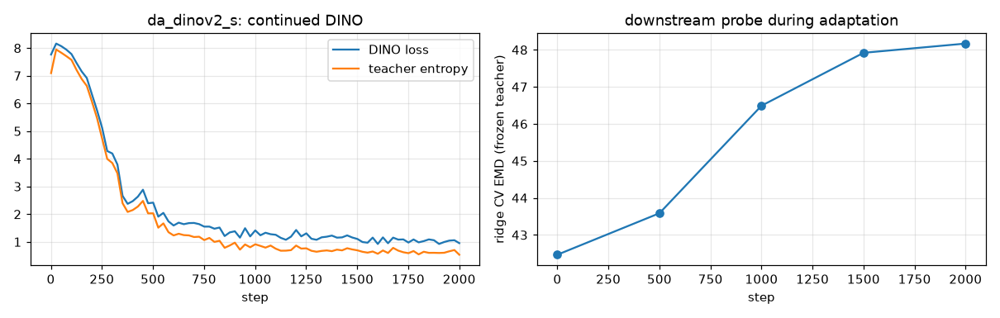
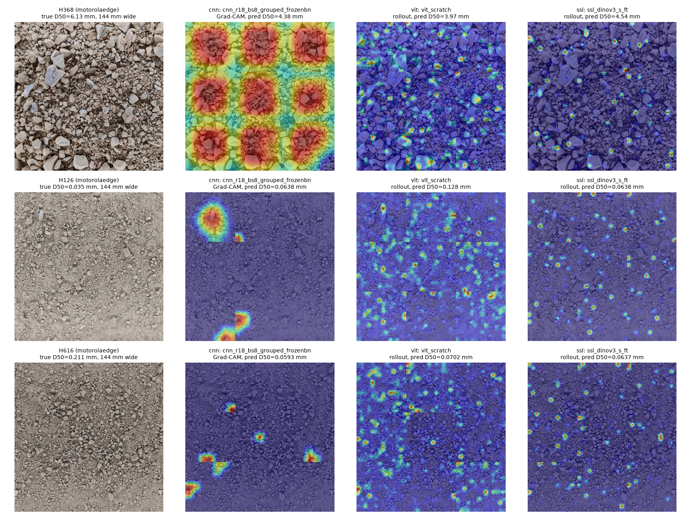

# AI401 Assignment 1: soil grain-size distribution from photos

Kaggle: [Predicting Soil Grain Size Distributions from Images](https://www.kaggle.com/competitions/soil-grain-size-from-photos).
From smartphone photos of a soil sample, predict the cumulative percentage passing 11 sieves (0.002-200 mm).
The same problem is solved with CNNs, with Vision Transformers and with self-supervised encoders, on one tiling
pipeline and one set of folds.

## Summary

| | CV EMD (6 group folds) | public LB |
|---|---|---|
| uniform curve (Kaggle baseline) | 102.0 ± 5.5 | — |
| training-mean curve | 86.6 ± 3.0 | 102.4 |
| colour statistics + ridge (no texture) | 49.7 ± 15.8 | — |
| best CNN: ResNet-18, frozen BN | 35.9 ± 17.2 | 86.3 |
| best ViT: small ViT trained from scratch | 35.3 ± 17.1 | 79.3 |
| best SSL: DINOv3 ViT-S/16, full fine-tuning | **34.1 ± 16.0** | 79.9 |
| **final: equal-weight ensemble of 5 diverse models** | **33.5 ± 15.8** | **77.1** |

All numbers are log-EMD (percent x decades, lower is better). The full table of 72 runs, with CV, D50 error,
controls, scale robustness, CKA and compute, is in [results/tables.md](results/tables.md) and `results/results.csv`.
The final submission ([results/submissions/final.csv](results/submissions/final.csv)) was chosen by CV, not by the
public LB, which covers only 3 test soils. Total compute: 1.44 GPU-hours on one RTX 4090 (48 GB), peak memory
10.7 GB (DINO adaptation), all other runs under 8 GB.

Main findings:

1. **Scale is the largest single factor and must come from metadata.** Most training photos are stored 2.5-5.8x
   smaller than the resolution `ppm_updated.csv` refers to. Ignoring that alone would cost 40-76 EMD. All photos
   are resampled to the density of the training photos (4.67 px/mm), and every tile covers 48 x 48 mm.
2. **With 24 soils, fold variance (std 15-20) is larger than most differences between methods.** Differences
   below about 5 EMD are not significant, so the conclusions below rely on effects that are large or consistent.
3. **Results by soil class:** gravels are easiest (EMD about 26-28), fine soils are in the middle (32-35), and
   the 4 sands are the hardest (about 60) for every family. Models learn the two dominant modes (fine vs gravel)
   and pull intermediate soils towards one of them.
4. **What helped:** keeping pretrained statistics (frozen BN, GroupNorm), frozen or gently tuned self-supervised
   features (k-NN on DINOv3 features: 36.6 with the lowest fold std), full fine-tuning of DINOv3, and ensembling
   models with less correlated errors.
5. **What did not help:** BatchNorm with batches from only 2 soils (+15 EMD), strong augmentations on CNNs, LoRA,
   continued DINO pretraining for the last-layer features, and higher-capacity backbones (ResNet-50, ConvNeXt-T,
   EfficientNet-B0 are no better than ResNet-18).
6. **CV to LB gap (34 -> 77-80).** The test photos come from iPhones that never appear in training, and the 3
   public soils differ from the training distribution (the training-mean curve scores 86.6 in CV but 102.4 on the
   public LB). Rankings agree between CV and LB: ensemble < SSL/ViT < CNN < baseline.

## Part 0. Data, metric, validation

### EDA (`notebooks/assignment1.ipynb`, `results/eda/`)

| | train | test |
|---|---|---|
| physical samples | 24 | 10 (public LB = 3 fixed samples) |
| photos | 127 (3-8 per sample) | 35 |
| cameras | Motorola Edge (69), Samsung A52 (55), Motorola Edge 60 fusion (3) | iPhone 14 (14), iPhone 16 (21) |
| stored resolution | 1600 x 720 and 1599 x 1200 (messenger-compressed), 4096 x 2304 | 4032 x 3024, 5712 x 4284 (native) |
| pixels per mm | 4.60, 4.55, 12.5 | 13.9, 19.5 |
| field of view | about 350 x 160-260 mm | about 290 x 220 mm |

- **Scale.** `ppm_updated.csv` gives ppm at each camera's native resolution. Most training photos are stored 2.5x
  (Motorola) and 5.8x (Samsung) smaller, so the effective ppm is the table value times the size ratio. A
  pipeline that takes the table value at face value is off by a factor of 2.5-5.8, i.e. 40-76 EMD from scale alone.
  The host says every photo is taken from 21 cm. As a check of the Samsung scale, `scripts/calibrate.py` estimates
  it without labels: the radially averaged texture spectrum (in cycles per mm) of the Samsung photos is matched to
  the Motorola photos of the same 21 soils. It gives 4.8 px/mm against the table's 4.55, the same +5% bias that
  the method shows on a Motorola-vs-Motorola self-check (`results/calibration/samsung_ppm.png`).
- **Domain shift.** The training photos are low resolution and recompressed. The test photos come from two
  phones never seen in training, at 3-4x the pixel density.
- **Curves are bimodal.** 9 fine soils (D50 0.02-0.1 mm, 37-90% finer than 0.063 mm), 11 gravels (D50 2.5-6 mm, 52-77%
  coarser than 2 mm), 4 sands in between. At the common density of 0.21 mm per pixel, clay, silt and fine sand
  are below one pixel, so the left half of every curve has to be inferred from colour and surface appearance.
- **Backgrounds.** Samsung photos show the whole tray with its rim and an LED strip; Motorola and iPhone photos show
  a tray edge on one side. Tiles are taken from the central 70% of the frame only.

### Metric

EMD = sum_{i=1..10} |F_i - F^_i| (log10 x_{i+1} - log10 x_i), in percent x decades, range [0, 500]
(`src/soilgs/metric.py`). It is the Wasserstein-1 distance between the two grain-size distributions on a
log-diameter axis, i.e. the area between the two grading curves on the usual semi-log plot.

- **Strengths:** physically meaningful, every decade of grain size counts the same, linear in the error (robust), and
  usable directly as a training loss for a cumulative target.
- **Weaknesses / edge cases:** (1) a scale error moves the whole curve along log d; a factor-2 error alone costs
  100 x log10(2) = **30.1 EMD** (checked numerically in the notebook), more than the gap between a good and a naive
  model. (2) The clay/silt part (0.002-0.063 mm) is 1.5 of the 5 decades, but it is invisible in a photo.
  (3) The grid is coarse (about 0.5 decade per interval), so shifts inside one interval are invisible. (4) The 200 mm
  point is fixed at 100, and for fine soils the whole gravel range adds almost nothing.
- **Complementary metric:** errors of D10 / D30 / D50 / D60 in decades (0.30 = factor 2), reported for every run
  (`D50_err_dec`). Engineers read these numbers (Cu, Cc), and they separate "right shape, wrong position" from
  "wrong shape".
- **Alternative target:** the 11 bin masses (fraction between consecutive sieves) instead of the 10 cumulative
  values. A softmax over the bins followed by a cumulative sum always gives a valid curve (non-negative increments,
  ends at 100), and the EMD becomes a differentiable loss. All neural models here use this head. Ridge/k-NN
  predictions on cumulative values are repaired with clipping plus isotonic regression (PAV), which is the
  least-squares projection onto valid curves (closer to the raw prediction than a running maximum).

### Validation and input pipeline

- **Folds:** 6 group folds over physical samples (`results/data/folds.csv`), stratified by D50 (each block of 6
  samples sorted by D50 is dealt to the 6 folds), so every fold holds fine and coarse soils. All photos of a sample
  are on the same side. Predictions are averaged tile -> photo -> sample before scoring. CV = mean ± std of the
  per-fold mean EMD. Every experiment uses the same folds.
- **Tiles:** each photo is resampled with its ppm to 4.67 px/mm, the density of the training photos. The training
  photos are therefore never upsampled, and the test photos are downsampled to the same density. 48 x 48 mm tiles
  (224 px, 50% overlap, central 70% of the frame, at most 48 per photo) are cached once as uint8 arrays and kept on
  the GPU. 48 mm is about 10 medium-gravel grains across and still resolves coarse sand (2 mm = 9 px). 24 mm and
  96 mm caches are kept for the ablation. Extra caches for the robustness study rebuild the training photos with a
  wrong ppm (x0.5 ... x2) or at reduced pixel density with the correct ppm.
- **Augmentation is scale-safe:** dihedral flips/rotations and mild colour jitter only. Random-resized crops or zoom
  change mm-per-pixel, which changes the label.


## Part 1. CNNs

All runs: 600 steps, batch 32 (8 for the grouped runs, with 4x the steps), cosine schedule with 10% warmup, EMD
loss through the softmax-over-bins head (bias initialised to the training-fold mean distribution), bf16. Every
batch draws a physical sample uniformly, then a tile.

| run | CV | note |
|---|---|---|
| ResNet-18, AdamW 3e-4 (reference) | 43.3 ± 20.5 | |
| ResNet-18, SGD 0.01 + momentum | 40.3 ± 21.1 | SGD ≈ AdamW |
| ResNet-18, constant LR, no warmup | 42.2 ± 17.4 | schedule barely matters |
| ResNet-18, frozen BN statistics | 39.5 ± 18.3 | |
| ResNet-18, BN -> GroupNorm (affine kept) | 37.5 ± 16.2 | |
| ResNet-18, batch 8 from **2 soils**, trainable BN | **50.9 ± 22.3** | worst CNN |
| ResNet-18, batch 8 from **2 soils**, frozen BN | **35.9 ± 17.2** | best CNN |
| ResNet-18, no augmentation / strong augmentation | 41.4 / 46.1 | blur + noise hurt |
| ResNet-18, 24 mm / 96 mm tiles | 41.9 / 43.1 | 48 mm is fine |
| ResNet-18, 48 mm tile at 112 px | 42.5 | half the pixels, same result |
| ResNet-50 / EfficientNet-B0 / ConvNeXt-T AdamW / ConvNeXt-T SGD | 41.4 / 42.8 / 44.6 / 39.5 | bigger does not help |

**Which CNN inductive biases help.** Locality and translation equivariance followed by global average pooling
produce an orderless texture descriptor: the prediction does not depend on where a grain lies. That is exactly
what a grading curve is. The shuffle control confirms it: permuting 12 mm blocks inside a tile changes the CNN error
by less than 1 EMD. Hierarchical receptive fields also suit the range of grain sizes. **What hurts:** ImageNet
filters are tuned to object scale, not physical scale, so nothing in the architecture ties a filter to
millimetres. Pooling also discards the count and area fraction of the few large clasts, and those clasts carry the
mass in gravels.

**BatchNorm with correlated batches.** When a batch holds tiles of only 2 soils, the per-batch mean and variance
are statistics of those two soils. Normalising with them removes exactly the between-soil differences in
brightness, contrast and texture energy that carry the label. The running averages used at test time then differ
from what the network saw in training. Result: +15 EMD (50.9 vs 35.9 with the same batches but frozen statistics).
With normal batches, frozen BN (39.5) and GroupNorm (37.5), which normalise per sample, are both better than
trainable BN (43.3).

**Ablation summary:** the normalisation choice gives the largest effect (up to 15 EMD). The optimiser, schedule,
tile size, input resolution and depth are all within about 4 EMD, i.e. inside one fold-std.

## Part 2. ViTs

| run | CV | note |
|---|---|---|
| small ViT from scratch (patch 16, D 192, depth 6, 1500 steps) | **35.3 ± 17.1** | best ViT |
| DeiT-S, AdamW 1e-4, LLRD 0.75, drop path 0.1, no WD on norm/bias (reference) | 45.6 ± 20.5 | |
| DeiT-S without layer-wise LR decay | 45.8 | LLRD: no effect |
| DeiT-S without warmup | 46.3 | +0.7 |
| DeiT-S with SGD 0.01 | 40.2 | better than AdamW |
| DeiT-S, weight decay 0.3 on all parameters | 45.5 | no effect |
| DeiT-S without drop path | 47.7 | +2 |
| DeiT-S at 112 px (49 tokens) | 42.4 | better than 224 px |
| DeiT-S with strong augmentation | 44.4 | slightly better (it hurt the CNN) |
| Swin-T / MaxViT-T | 42.8 / 42.3 | local attention beats plain DeiT-S |
| frozen DeiT-S features + k-NN (Part 3 table) | 38.0 | |

**Prediction vs result.** I predicted a from-scratch ViT at about the training-mean level and pretrained DeiT-S near
ResNet-18. The opposite happened: the 2.9M-parameter scratch ViT is the best ViT, and fine-tuned DeiT-S is the worst
fine-tuned model. The grey control explains it. With colour removed, the scratch ViT goes from 35.3 to 48.8, while
the best CNN stays at 35.1. The scratch ViT is mostly a colour/brightness model: soil colour separates the clayey
fine soils from the gravels, and a small network learns that easily from 20 soils. Fine-tuning a pretrained ViT
with AdamW on 20 soils moves it far from its features without enough data to build better ones. SGD (smaller
effective steps), fewer tokens, frozen features + k-NN (38.0) or local attention (Swin, MaxViT) all improve on it.

**CNN vs ViT recipes.** For the CNN the decisive choice is normalisation (BN statistics), and augmentation strength
should be mild. For the ViT the decisive choice is how far fine-tuning moves the pretrained weights (SGD, frozen
features, drop path all help), and stronger augmentation is neutral to helpful. The general reason: a CNN brings
locality and weight sharing with it, while a ViT has to learn them from data or keep them from pretraining. With
24 soils it cannot learn them, so for ViTs everything depends on not destroying what pretraining gave.
Warmup and LLRD, which matter on large datasets, change nothing here (< 1 EMD): 600 small steps from a good init
never reach the unstable regime they are meant to prevent.

## Part 3. Self-supervised encoders

Encoders: DINOv2 ViT-S/14 (`vit_small_patch14_dinov2.lvd142m`), DINOv3 ViT-S/16 (`vit_small_patch16_dinov3.lvd1689m`),
and the supervised DeiT-S as a reference. Frozen protocols: per-sample mean of tile features, then ridge (alpha by
leave-one-out inside the training fold) or cosine k-NN (k=5, softmax weights with temperature 0.1, z-scored
features). A linear probe is trained on tile features with the EMD loss. Feature sets: CLS, mean patch token,
both, and the mean patch tokens of blocks 4 and 8.

| encoder | ridge CLS | ridge patch | ridge block 4 | ridge block 8 | k-NN | linear probe | LP-FT | full FT | LoRA r=8 |
|---|---|---|---|---|---|---|---|---|---|
| DeiT-S (supervised) | 45.2 | 41.7 | 40.6 | 40.9 | 38.0 | 41.4 | | | |
| DINOv2-S | 42.6 | 42.4 | 40.6 | 43.0 | 39.2 | 44.3 | 40.7 (CKA 0.84) | 44.1 (CKA 0.68) | 46.5 (CKA 0.65) |
| DINOv3-S | 41.4 | 42.1 | 42.9 | 43.5 | **36.6 ± 10.5** | 45.0 | 37.7 (CKA 0.97) | **34.1 ± 16.0** (CKA 0.80) | 44.9 (CKA 0.69) |
| DINOv2-S after DINO adaptation | 49.5 | 46.9 | **36.5** | 44.3 | 37.3 | 45.8 | 47.5 (CKA 0.87) | | 48.9 (CKA 0.62) |

CKA = linear CKA between the encoder's pre-head features before and after tuning, on validation tiles, averaged over folds.

- **Frozen features are competitive.** k-NN on frozen DINOv3 features (36.6) is within 2.5 EMD of the best model, has
  the lowest fold std of all runs (10.5 vs 16-22), trains in seconds and is the least correlated with the
  fine-tuned models (that is why it is in the final ensemble).
- **Fine-tuning can be worse than frozen features.** For DINOv2 every tuning strategy (40.7-46.5) is worse than
  frozen k-NN (39.2). The CKA explains it: the strategies that move the representation most (FT 0.68, LoRA 0.65)
  are the worst, and LP-FT, which starts from a trained head and moves the features least (0.84), is the best tuned
  variant. That is feature distortion: with a random head, the first large gradients rewrite the features to fit 20
  soils. DINOv3 is the exception: full FT reaches the best single score (34.1) at CKA 0.80, while LP-FT barely
  moves the features (0.97) and stays at 37.7. With LR 2e-5 after the probe, LP-FT simply adapted too little.
- **LoRA is the worst tuning strategy for both encoders.** At LR 1e-3 it changes the representation more than full
  FT (CKA 0.62-0.69). On ~4k tiles of 20 soils, a low-rank update of every attention projection overfits the
  training soils.
- **Intermediate layers.** For DINOv2 and the supervised DeiT-S, block 4 is better than the last layer for ridge.
  For a texture-statistics task, mid-level features (edges, blobs, grain boundaries) are closer to what matters than
  the semantic last layer.

**Domain adaptation (continued DINO on unlabelled training tiles).** DINOv2-S student/teacher with a fresh
DINO head (4096 prototypes), EMA momentum 0.996 -> 1, centring + sharpening (teacher temperature 0.04), backbone
frozen for the first 200 steps, 2000 steps x 64 tiles, LR 2e-5. Two global views per tile plus 4 local 98 px
crops **cut without resizing**, so every view keeps the 4.67 px/mm of the cache. Only training photos were used.
Cost: 0.083 GPU-hours, 10.7 GB peak.



The DINO loss and the teacher entropy drop (no collapse: the entropy stays well above 0). But the downstream
probe on the last-layer features gets steadily worse (ridge CV 42.5 -> 48.2). The adaptation **hurt** the
last-layer features and LP-FT/LoRA (40.7 -> 47.5, 46.5 -> 48.9). It **helped** the block-4 features (40.6 -> 36.5)
and k-NN (39.2 -> 37.3). My reading: on 4.6k tiles of 24 soils, the self-distillation objective rewards features
that tell individual soils and photos apart (lighting, colour, tray), and the last layers move towards that and
forget generic structure. The early layers only sharpen their texture filters. Answer: it did not help for the
final models; for frozen mid-level features it gave -4 EMD at the cost of 5 GPU-minutes.

**Label-destroying augmentations.** Anything that changes mm per pixel: random-resized crops, zoom, rescaled
multi-crop and, to a lesser degree, blur (it removes the finest grains). DINO's default multi-crop rescales a
5-40% crop to 96 px, which teaches invariance to exactly the variable we want to predict. The scale-safe
multi-crop above cuts local crops at the native density instead. Strong augmentation with blur measurably hurt
the CNN (+2.8 EMD).

## Part 4. Interpretation and shortcut controls



Fold-0 models on unseen validation soils: a gravel (H368, best case), a clayey fine soil (H126) and a sand (H616,
the failure case: true D50 0.21 mm, all models predict 0.06-0.07 mm). The CNN uses Grad-CAM of the predicted mean
log-diameter (each 48 mm tile normalised separately). The ViTs use attention rollout.

- **CNN:** on the gravel the map covers the large clasts. On the fine and sandy soils it fires only on the few
  largest grains; for a "how coarse is it" output these are exactly the evidence that should matter.
- **ViT / DINOv3:** rollout is spread over many small bright grains and grain edges, not over the background.
- **No background shortcut is visible:** the tray rim and the LED strip are cut away by the 70% ROI, and none of the maps concentrate on tile borders or on uniform areas.

Numeric controls (CV EMD; each control changes only the evaluation input of the same trained models, or uses
only the named information):

| control | result | conclusion |
|---|---|---|
| camera / ppm only (no pixels) | 87.1 vs 86.6 for the training mean | no camera shortcut: both phones photographed nearly every soil |
| colour statistics only + ridge | 49.7 | colour carries a lot (soil colour ↔ clay content), but texture adds 15 more EMD |
| grey input, best CNN / DINOv3 FT / scratch ViT | 35.1 / 34.2 / **48.8** (from 35.9 / 34.1 / 35.3) | CNN and DINOv3 use texture; the scratch ViT relies on colour |
| 12 mm blocks shuffled inside each tile | within ±1 EMD for every model | the models read texture statistics, not spatial layout (consistent with Appendix-1 permutation invariance) |
| pipeline believes ppm x2 / x0.5 (CNN, DINOv3 FT) | +6 / +10, +4 / +6 | the models do use scale, but less than the 30 EMD a pure scale shift would cost |

## Part 5. Conclusions on optimisation

- **CNNs:** what worked was keeping the pretrained normalisation statistics (frozen BN, GroupNorm), mild
  augmentation, and the smallest backbone. What did not work: trainable BN with sample-correlated batches,
  blur/noise augmentation, larger backbones. SGD ≈ AdamW; warmup and schedule did not matter.
- **ViTs:** what worked was anything that limits how far fine-tuning moves the pretrained weights (SGD, frozen
  features + k-NN, drop path), local attention (Swin/MaxViT), and fewer tokens. Warmup, LLRD and the weight decay
  scope had no measurable effect at this data size. A small ViT from scratch learned a strong colour model.
- **SSL:** frozen k-NN is a strong, stable baseline. Fine-tuning only pays off with an encoder whose features
  already fit (DINOv3) and with a moderate amount of movement (CKA about 0.8). LoRA and continued DINO on so few
  images distort the features.
- **Hypotheses that turned out wrong** (details in [HYPOTHESES.md](HYPOTHESES.md)): the scratch ViT is not at
  baseline level but the best ViT (H2.1); SGD does not break the ViT, it beats AdamW (H2.2); the hardest soils are
  the sands, not the fine soils (H0.2); the improvement over the training mean is about 60%, not 20-35% (H0.3);
  DINO adaptation hurt the last-layer features instead of being neutral (H3.4).

## Part 6. Comparison of approaches

| best model | CV | LB | GPU-hours (6 folds) | peak mem | params | grey | res x0.5 / x0.25 | ppm x0.5 / x2 |
|---|---|---|---|---|---|---|---|---|
| CNN: ResNet-18 frozen BN, 2-soil batches | 35.9 ± 17.2 | 86.3 | 0.053 | 3.2 GB | 11.2M | 35.1 | 36.9 / 39.7 | 46.4 / 42.4 |
| ViT: small ViT from scratch | 35.3 ± 17.1 | 79.3 | 0.038 | 2.5 GB | 2.9M | 48.8 | 36.9 / 45.1 | 45.3 / 39.0 |
| SSL: DINOv3-S full FT | 34.1 ± 16.0 | 79.9 | 0.048 | 3.7 GB | 21.6M | 34.2 | 34.4 / 35.9 | 39.8 / 37.9 |
| SSL frozen: DINOv3-S + k-NN | 36.6 ± 10.5 | — | < 0.01 | 3.3 GB | 0 | 38.4 | 38.3 / 38.3 | 39.0 / 37.9 |

The robustness columns re-tile the validation photos of every fold: "res" = the same photo at half or a quarter of
the pixel density with the correct ppm (the reference with the same protocol: CNN 36.4, ViT 34.9, DINOv3 34.2, k-NN
36.9). "ppm" = a mis-calibrated scale. Plot: `results/figures/scale_robustness.png`.

- **Quality:** the three families are within 2 EMD of each other, well inside one fold-std. Self-supervised
  pretraining gives the best single model and the most stable frozen model.
- **Cost:** everything is cheap (2-3 GPU-minutes per 6-fold run); frozen features cost seconds.
- **Data efficiency:** frozen DINOv3 + k-NN needs no training at all and has the lowest variance across folds.
- **Robustness to scale:** DINOv3 (FT or frozen) loses the least when resolution drops (+0.2 / +1.7 EMD) and when the
  ppm is wrong. The scratch ViT is the most fragile (+10 at a quarter resolution); its colour features survive, but
  its texture cue disappears.
- **Where each fails:** all families fail on the sands (EMD about 60, `results/error_by_class.csv`), and all of
  them pull sands towards a fine soil. SSL is best on fine soils (31.9 vs 35.4); all are similar on gravels (26-28).
  On the test cameras (iPhone) all lose 44-50 EMD; the colour-reliant scratch ViT does not lose more than the
  texture models.

## Part 7. Ensemble

Signed, log-width-weighted OOF residuals (per sample and sieve) are correlated at 0.89-0.98 between the family-best
fine-tuned models (`results/oof_error_corr.csv`): they make the same mistakes on the same soils. Frozen k-NN models
are the least correlated with them (0.72-0.80).

| ensemble (equal weights) | CV | mean pairwise error corr. |
|---|---|---|
| best single (DINOv3 FT) | 34.06 ± 16.04 | — |
| best of each family (DINOv3 FT + ResNet-18 + scratch ViT) | 33.92 ± 16.92 | 0.93 |
| 2 most diverse among the top 12 (scratch ViT + DINOv3 k-NN) | 33.93 ± 15.19 | 0.72 |
| 3 most diverse (DINOv3 FT + DINOv2-DA ridge block 4 + DINOv3 k-NN) | 33.68 ± 14.05 | 0.79 |
| **top-5 by CV (DINOv3 FT, scratch ViT, ResNet-18, DINOv2-DA ridge, DINOv3 k-NN)** | **33.53 ± 15.81** | 0.84 |

The ensemble gains 1.6% in CV (34.06 -> 33.53) and 3.5% on the public LB (79.85 -> 77.08). The gain is small
because the errors are highly correlated: averaging only cancels the uncorrelated part of the errors, and here most
of the error is shared bias (sands pulled towards fine soils, and the camera shift). Adding the
least-correlated members (k-NN, ridge on another encoder) lowers the fold std more than the mean. Diverse models
beat a blend of the "best" ones: the three family bests (corr 0.93) gain almost nothing. The final submission is
the top-5 blend, chosen by CV only. With 24 soils the choice among ensembles within 0.4 EMD is not meaningful, so
it was not tuned further (no weight optimisation on OOF).

## Checkpoints

Fold checkpoints (fp16) of the three family-best models (`cnn_r18_bs8_grouped_frozenbn`, `vit_scratch`,
`ssl_dinov3_s_ft`, 6 folds each) and the DINO-adapted DINOv2-S backbone (`checkpoints/da_dinov2_s/backbone.pt`)
are kept out of git (492 MB). `scripts/predict.py` uses them. Every other run is reproduced by
`scripts/run.py --only <name>` in 1-8 minutes.

## Repository

| path | what |
|---|---|
| `config.yaml` | data/tiling settings and every reported experiment (defaults + overrides) |
| `src/soilgs/metric.py` | competition EMD, D-value errors, curve repair (clip + isotonic PAV) |
| `src/soilgs/tiles.py`, `data.py` | photo index and ppm, calibrated tiling, tile caches, group folds |
| `src/soilgs/models.py` | timm backbones, from-scratch ViT, softmax-over-bins curve head, EMD loss, LoRA, BN/GN handling, scale-safe GPU augmentation |
| `src/soilgs/train.py` | CV training of one experiment: OOF + test predictions, controls, scale robustness, CKA, compute log |
| `src/soilgs/frozen.py` | frozen SSL features: ridge (5 feature sets), weighted k-NN, linear probe |
| `src/soilgs/dino.py` | continued DINO self-distillation (domain adaptation) with scale-safe multi-crop |
| `scripts/prepare.py` | index, EDA, folds, all tile caches (`results/data/folds.csv` is the fold file) |
| `scripts/calibrate.py` | label-free check of a camera's ppm (texture spectra of the same soils) |
| `scripts/run.py` | runs experiments from the config (`--family cnn|vit|ssl`, `--only a,b`) |
| `scripts/baselines.py` | image-free baselines and shortcut controls |
| `scripts/interpret.py` | Grad-CAM / attention rollout maps for the best model of each family |
| `scripts/ensemble.py`, `report.py`, `submit.py` | OOF error correlation and ensembles; tables and figures; Kaggle submission |
| `scripts/predict.py` | inference: photo(s) + pixels-per-mm -> valid curve |
| `notebooks/assignment1.ipynb` | EDA, metric analysis and all result tables/figures (reads `results/` only) |
| `HYPOTHESES.md` | hypotheses written before each block of experiments, outcomes after |
| `results/` | per-experiment config, OOF, test predictions, metrics, compute (`results/exps/<name>/`), tables, figures |
| `remote/` | RunPod helpers (`runpod_ctl.py`, `pod.sh`, `setup.sh`, `run_all.sh`) |

Reproduce (one GPU, about 2 GPU-hours):

```bash
uv sync --frozen
uv run kaggle competitions download -c soil-grain-size-from-photos -p data/raw   # then unzip
bash remote/run_all.sh          # prepare -> baselines -> cnn -> vit -> ssl -> interpret -> ensemble -> report
uv run python scripts/predict.py --ppm 13.942 photo1.jpg photo2.jpg --exps <experiment>
```

Software: Python 3.12, torch 2.14.1+cu126, timm 1.0.30 (all pinned in `uv.lock`), bf16 autocast. Pretrained weights
(timm tags): `resnet18.tv_in1k`, `resnet50.a1_in1k`, `efficientnet_b0.ra_in1k`, `convnext_tiny.fb_in22k_ft_in1k`,
`deit_small_patch16_224.fb_in1k`, `swin_tiny_patch4_window7_224.ms_in22k_ft_in1k`, `maxvit_tiny_tf_224.in1k`,
`vit_small_patch14_dinov2.lvd142m`, `vit_small_patch16_dinov3.lvd1689m`. No external labelled soil data, no manual
labels. Only training photos are used for self-supervised adaptation (test photos are never used for training).
Nothing depends on test file names or ids except reading them.
